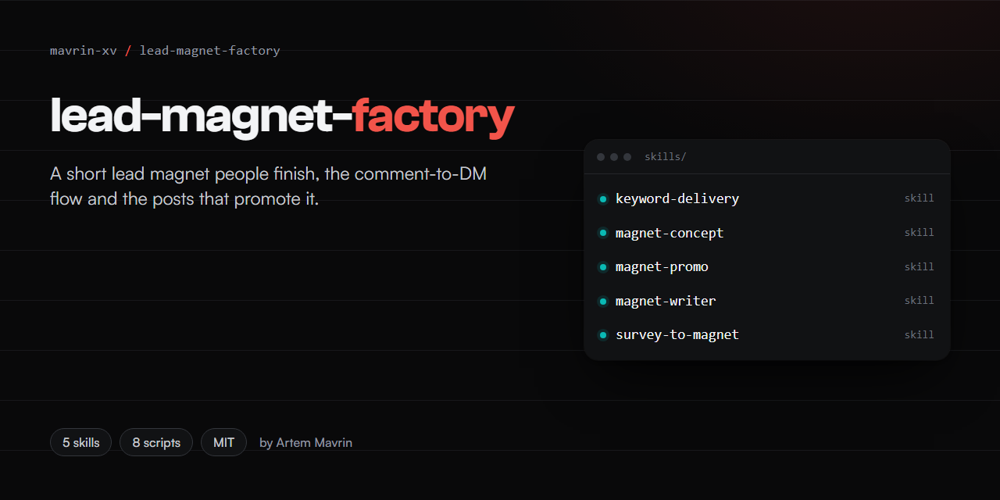

# lead-magnet-factory

**Turn an article, a voice note, research notes or survey answers into a lead magnet people finish, plus the comment-to-DM delivery flow and the posts that promote it. For creators, consultants and small businesses that sell something after the freebie.**

Most lead magnets are a 30-page PDF nobody opens, sent by a DM flow nobody tested, announced with "comment GUIDE" and nothing else. This pack picks one painful problem, writes a short magnet with a 15-minute win, and checks every step with a script.

  

```bash
git clone https://github.com/mavrin-xv/lead-magnet-factory && cd lead-magnet-factory
./install.sh            # or: ./install.sh --project  (this project only)
```

<!-- install-notes:start -->
Other ways in: as a Claude Code plugin, run `/plugin marketplace add mavrin-xv/lead-magnet-factory` and then `/plugin install lead-magnet-factory@lead-magnet-factory`. For Codex or another agent that reads `SKILL.md`, copy the folders under `skills/` into its skills directory. On Windows, run `install.sh` from Git Bash or WSL and type `py -3` where these docs say `python3`.
<!-- install-notes:end -->

## What it solves

| Pain | What the pack does |
|---|---|
| You do not know what to give away | `magnet-concept` drafts 3 to 5 concepts and scores each on five tests (specific, bridge to the offer, quick win, value, AI-proof). A script rejects any concept below 3 |
| You have survey answers but no idea what they say | `survey-to-magnet` clusters the open answers, ranks themes by size, depth and pain words, and pulls the quotes to use in the hook |
| The magnet is long, vague and never finished | `magnet-writer` writes one of six formats with a quick win near the top and a single next step, then `magnet_lint.py` fails it on item counts, long paragraphs, leftover placeholders and missing calls to action |
| Publishing means copying into Notion by hand | One `magnet.md` becomes a standalone HTML page (checkboxes, copy buttons, dark mode, print) and a Notion page through the API |
| The DM flow breaks quietly or gets the account limited | `keyword-delivery` builds the flow from one JSON file and checks keyword, reply length, link placement, button label, disclosure and the 24-hour window, then writes a setup sheet and a test plan |
| "Comment GUIDE" posts get no comments | `magnet-promo` writes a post per platform that gives one real item away first, and `promo_check.py` checks limits, keyword placement and link rules |

## What's inside

| Skill | What it does | Say |
|---|---|---|
| [magnet-concept](skills/magnet-concept/SKILL.md) | Brief in five lines, 3 to 5 concepts across types and formats, five-test scoring, title, concept card | "lead magnet idea", "what should I give away" |
| [survey-to-magnet](skills/survey-to-magnet/SKILL.md) | Two-question survey, theme clustering of the answers, quotes and a suggested format | "I ran a survey", "what do my customers struggle with" |
| [magnet-writer](skills/magnet-writer/SKILL.md) | Checklist, playbook, swipe file, template, mini-course or hub page, linted, exported to HTML and Notion | "write the lead magnet", "make the checklist" |
| [keyword-delivery](skills/keyword-delivery/SKILL.md) | Comment keyword to DM to link, Telegram start links or form plus email, tagged links, test plan | "comment to DM", "ManyChat flow", "how do I deliver it" |
| [magnet-promo](skills/magnet-promo/SKILL.md) | Give-away posts for X, Threads, LinkedIn, Instagram, TikTok, Telegram and newsletters, plus a launch checklist | "promote my lead magnet", "write the launch posts" |

Scripts (Python standard library, each with `--help`): `score_concepts.py`, `cluster_survey.py`, `magnet_lint.py`, `md_to_html.py`, `md_to_notion.py`, `flow_builder.py`, `promo_check.py`.

## Quick start

1. Install, then open Claude Code in your project.
2. Paste your input and ask:
   ```
   > Here is a voice note from a coffee roaster. We sell a wholesale bean
     subscription to small cafes. Turn this into a lead magnet.
   ```
3. The skills run in order: concept card, then `magnets/<slug>/magnet.md`, then the HTML page, then the flow and the posts. You approve each step.

Run the scripts on the invented example first, from the repo root:

```bash
python3 skills/magnet-writer/scripts/magnet_lint.py examples/acme-coffee/magnet.md --format checklist --keyword DIALIN
python3 skills/magnet-writer/scripts/md_to_html.py examples/acme-coffee/magnet.md -o /tmp/magnet.html
python3 skills/keyword-delivery/scripts/flow_builder.py examples/acme-coffee/flow.json -o /tmp/flow.md
```

Sample output:

```
PASS title: 'Dial in your espresso in 15 minutes: 22 checks for small cafes'
PASS every paragraph is 3 sentences or fewer
PASS no unfilled placeholders
PASS 22 checkbox items
PASS quick win section near the top
PASS Next step has 0 link(s)
PASS keyword DIALIN found in Next step
INFO 917 words, 39 blocks

OK: 0 fail(s), 0 warning(s)
```

The whole chain for an invented roaster (voice note, 24 survey answers, concepts, the checklist, its HTML and Notion versions, the flow and eight posts) is in [examples/acme-coffee/](examples/acme-coffee/).

## How it works

```
 input (article / voice note / research / topic)      survey CSV
        |                                                 |
        |                                  survey-to-magnet + cluster_survey.py
        v                                                 v
   magnet-concept + score_concepts.py  <---- themes and quotes
        | concept.md
        v
   magnet-writer + magnet_lint.py
        | magnet.md --> md_to_html.py   --> magnet.html
        |           --> md_to_notion.py --> Notion page (NOTION_TOKEN)
        v
   keyword-delivery + flow_builder.py --> flow.md (setup sheet + test plan)
        v
   magnet-promo + promo_check.py      --> promo.md (one post per platform)
```

The model makes the judgement calls: who the reader is, what to give away, every word. The scripts do the counting, so a placeholder left in, a link in a first DM or a caption over the limit is caught every time. Longer walkthrough: [docs/how-it-works.md](docs/how-it-works.md). Markdown the scripts understand: [docs/markdown-conventions.md](docs/markdown-conventions.md).

## Configure

| What | Where |
|---|---|
| Notion | env `NOTION_TOKEN` (an internal integration token), share the parent page with the integration, then `md_to_notion.py --push --parent <page id>`. Details in `skills/magnet-writer/references/notion-output.md` |
| Page colour | `md_to_html.py --accent "#2f6f4f"` |
| Delivery flow | `flow.json`, start from `templates/flow.example.json` or `flow_builder.py --init` |
| Formats and their structure | `skills/magnet-writer/references/format-structures.md` and the files in `templates/` |
| Platform limits and link rules | the `LIMITS` table at the top of `promo_check.py` |

## Honest limits

- The scripts were run on the example data only. The Notion push was tested as a dry run; a live push to your workspace was not run by the authors.
- `flow_builder.py` writes a setup sheet. It does not connect to ManyChat, Meta or Telegram, and it cannot see whether your account is allowed to automate DMs.
- Platform rules change. The 24-hour messaging window, one private reply per comment and character limits were current when written; check them before a launch.
- Survey clustering is word overlap, not meaning. "Sour shots" and "under-extracted espresso" can land in different themes. Under 15 answers the themes are a guess, and the script says so.
- The lint checks structure, not quality. A magnet can pass every check and still be dull; the judgement half of the gate in `skills/magnet-writer/references/quality-gate.md` is done by the model and by you.
- No invented proof. The skills refuse numbers that are not in your input or a cited source, which means your first draft may have gaps marked `[NEEDS SOURCE]`.

## Credits

- Five concept tests, magnet types, interactive formats and their security rules: inspired by the lead-magnet skill in https://github.com/boringmarketer/boring-marketing-skills (MIT).
- Survey to magnet flow (open question, theme ranking, quotes, outline): inspired by `conversion-ops` in https://github.com/ericosiu/ai-marketing-skills (MIT). Rewritten with the standard library, no code copied.
- Format list and gating options: inspired by the lead-magnets skill in https://github.com/coreyhaines31/marketingskills (ideas only).
- Format-to-buyer-stage mapping: inspired by https://www.skills.sh/rampstackco/claude-skills/lead-magnet-design (ideas only).
- Comment-to-DM practice: https://www.planoly.com/blog/instagram-comment-to-dm-best-practices and https://manychat.com/blog/comments-automation (ideas only); platform rules from https://developers.facebook.com/docs/messenger-platform/instagram/features/private-replies/ and https://developers.facebook.com/docs/messenger-platform/policy/policy-overview.
- Reveal-a-problem, sample and one-step magnet types: from Alex Hormozi, *$100M Leads* (ideas only).
- The single open survey question and answer-depth weighting: from Ryan Levesque's Ask Method, https://digitalmarketer.com/ryan-levesque-avatar-campaigns/ (ideas only).
- Repo and skill layout: modelled on https://github.com/anthropics/skills and https://github.com/obra/superpowers (MIT).

## Contributing

See [CONTRIBUTING.md](CONTRIBUTING.md). Agents working on the repo: [AGENTS.md](AGENTS.md).

<!-- author:start -->
## Author

Built and maintained by [Artem Mavrin](https://github.com/mavrin-xv). This repo is one of a set of agent skill packs for marketing and operations work. Each one installs on its own; the full list is in [agent-skill-packs](https://github.com/mavrin-xv/agent-skill-packs). If a pack saved you an afternoon, a star helps other people find it.
<!-- author:end -->

## License

MIT. See [LICENSE](LICENSE).
